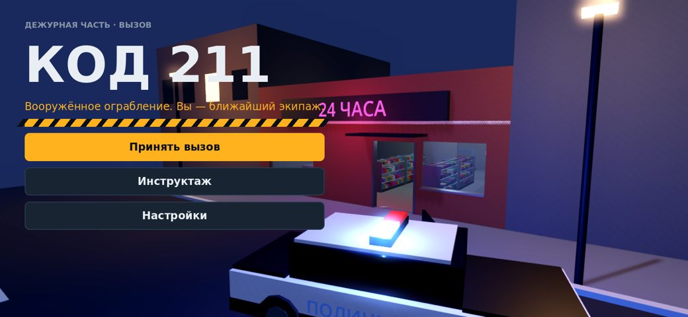
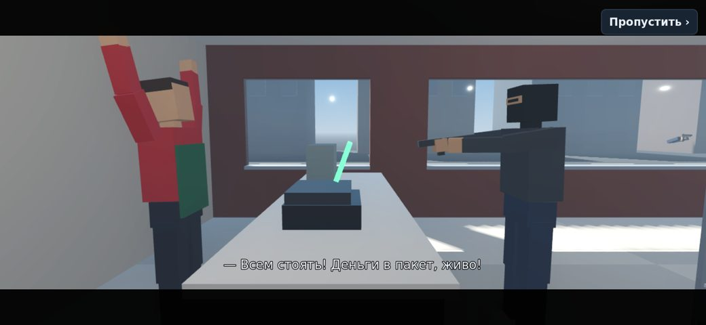
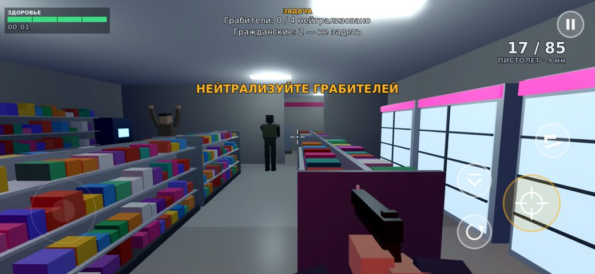

# Код 211

Тактический шутер от первого лица для iPhone. Вы — патрульный, первым приехавший
на вызов «код 211» (вооружённое ограбление) в мини-маркет. Движок — **Godot 4.3**
(Mobile-рендерер, Metal через MoltenVK). Вся игра собирается из кода: уровни, модели,
анимации, звук и интерфейс генерируются при запуске, поэтому проект работает
«из коробки», без внешних ассетов. Модели из Blender-пайплайна (`blender/`)
подменяют встроенные автоматически, если положить их в `godot/assets/models/`.





## Что внутри

| Часть | Где | Что делает |
|---|---|---|
| Вступительный ролик | `scripts/gameplay/cutscene.gd` | Грабители врываются в магазин, угроза кассиру, рация диспетчера, патрульная машина с мигалками, коп выходит, камера «влетает» в глаза игрока. Пропуск в любой момент даёт то же итоговое состояние. |
| Игрок | `scripts/gameplay/player.gd`, `viewmodel.gd` | Вид от первого лица. Пистолет: магазин 17, запас 85, отдача, растущий разброс, тактическая и полная перезарядка. Дубинка: первый удар оглушает, второй — арест. Присед для укрытия. |
| ИИ грабителей | `scripts/gameplay/bandit.gd` | Конечный автомат: ограбление/патруль → тревога (зрение, шум выстрела, ранение) → бег в укрытие → выглядывание и прицельная стрельба / стрельба вслепую → перезарядка в укрытии → смена позиции при обходе с фланга. Броня: лёгкая, средняя (бронежилет), тяжёлая (жилет + шлем). |
| Укрытия | `level_builder.gd`, `cover_point.gd` | Генерируются вокруг стеллажей, касс, морозилок, колонн; проверяются по навмешу; низкие (присесть) и высокие (выглянуть из-за угла). |
| Справедливость боя | `mission.gd` | «Жетоны огня»: одновременно стреляют 1/2/3 грабителя (по сложности). Пули грабителей не задевают гражданских — провал всегда зависит от игрока. |
| Карты | `scripts/gameplay/missions.gd` | «Угловой магазин» (день, 3 грабителя), «Ночная бодега» (ночь, мерцающая лампа, подсобка, заложник, 4 грабителя), «Даунтаун-маркет» (дождь, колонны, два входа, 5 грабителей с тяжёлой бронёй). |
| Управление | `scripts/ui/touch_controls.gd` | Плавающий джойстик, обзор свайпом, кнопки огня/перезарядки/оружия/приседа/паузы. Мультитач по индексам пальцев: можно идти, целиться и стрелять одновременно. Палец на кнопке огня тоже крутит камеру. |
| HUD | `scripts/ui/hud.gd` | Здоровье, патроны, задачи, таймер, прицел с разбросом, хитмаркер, индикатор направления урона, красная виньетка при низком здоровье, лента событий, учёт выреза экрана. |
| Меню | `scripts/ui/*.gd` | Главное меню на живом 3D-фоне, выбор миссии и сложности, инструктаж, пауза (с подтверждением выхода), итоги с оценкой S/A/B/C, звёздами и разбором очков. |
| Настройки | `scripts/autoload/settings.gd`, `ui/settings_panel.gd` | Качество (масштаб рендера, MSAA, свечение, туман, дождь), тени (выкл/низкие/высокие), лимит 30/60 FPS, громкость (общая/фон/эффекты), чувствительность, помощь в прицеливании, инверсия. Сохраняются между запусками. |
| Звук | `scripts/autoload/sfx.gd` | Синтезируется при старте: выстрелы, перезарядка, дубинка, сирена, рация, дождь, гул ламп. Пул 2D/3D-плееров. Свои .wav/.ogg в `assets/audio/<имя>` подменяют синтез. |

## Что проверено и что нет

Проверено здесь (Linux, Godot 4.3):

- **79 автотестов** (`tests/test_runner.gd`), все проходят. Они покрывают: загрузку всех трёх карт, путь по навмешу до каждого грабителя, полный ролик и его пропуск, оглушение и арест дубинкой, боевой цикл ИИ (укрытие → выглядывание → перезарядка), урон с учётом брони, победу и подсчёт очков, оба вида поражения, одновременный мультитач (движение + обзор + огонь), паузу, сохранение настроек, 4 перезапуска миссии без роста числа узлов и без «осиротевших» узлов.
- **Скриншоты с реальным рендерером** (OpenGL через Xvfb, `tests/screenshots.gd`) — меню, ролики, бой и итоги всех миссий.
- **Импорт `.glb`**: модель, экспортированная в glTF (`tools/export_reference_glb.gd`), подхватывается игрой вместо встроенной, все 20 клипов проигрываются.

**Не проверено** (в контейнере нет Mac, Xcode, iPhone и Blender):

- Сборка `.ipa` и запуск на iPhone. Реальные 60 FPS и нагрев устройства не измерены. Mobile-рендерер на Metal выглядит немного иначе, чем OpenGL на скриншотах.
- Blender-скрипты (`blender/`) ни разу не запускались в настоящем Blender: сеть контейнера блокирует download.blender.org и PyPI. Проверены только Python-логика (прогоном с заглушкой `bpy`) и спецификация (`python3 blender/spec.py`). Вызовы Blender API могут потребовать правок.

«Ноль багов» никто честно гарантировать не может. Гарантировать можно другое: каждая заявленная механика покрыта тестом, а найденные при разработке баги исправлены (список ниже).

## Сборка на iPhone

Нужно: Mac, **Xcode 15+**, **Godot 4.3** (stable) и Apple ID (для своего телефона хватит бесплатного; для TestFlight/App Store нужен Apple Developer Program).

1. Установите Godot 4.3 и шаблоны экспорта: *Editor → Manage Export Templates → Download and Install*.
2. Откройте `code211/godot/project.godot` в Godot. Первый импорт займёт несколько секунд.
3. Нажмите *F5*: игра запустится на Mac. Управление: WASD, мышь (клик захватывает курсор), ЛКМ — огонь, R — перезарядка, Q — смена оружия, C — присед, Esc — пауза, пробел — пропустить ролик.
4. *Project → Export → iOS* (пресет уже есть):
   - **App Store Team ID** — из https://developer.apple.com/account (раздел Membership) или из Xcode → Settings → Accounts;
   - **Bundle Identifier** — замените `com.example.code211` на свой, например `com.вашеимя.code211`;
   - включите **Export Project Only**, если хотите собирать через Xcode (рекомендуется).
5. *Export Project* → получите папку с `.xcodeproj`. Откройте её в Xcode, выберите свой iPhone, в *Signing & Capabilities* — свою команду, нажмите **Run**.
6. При первом запуске на телефоне: *Настройки → Основные → VPN и управление устройством* → доверить сертификат разработчика.

Рекомендованные настройки для iPhone 11 и старше: качество «Среднее», тени «Низкие», 60 FPS. Для iPhone XR/XS и для экономии батареи: «Низкое» + 30 FPS.

## Автотесты

```bash
cd code211/godot
godot --headless --import                       # первый раз
godot --headless --fixed-fps 60 res://tests/test_runner.tscn
```
Код выхода 0 — всё прошло. Скриншоты (нужен экран или Xvfb):
```bash
SHOT_DIR=/tmp/shots godot --rendering-method gl_compatibility --resolution 1560x720 res://tests/screenshots.tscn
```

## Blender-пайплайн

См. [docs/ASSET_PIPELINE.md](docs/ASSET_PIPELINE.md). Коротко:
```bash
blender -b -P code211/blender/build_assets.py -- --out code211/godot/assets/models --blend
```
Генерирует 6 персонажей с 20 анимациями (idle, walk, run, aim, shoot, reload, cover, cover_blind, hit, death, варианты «в приседе», arrested, stunned, hands_up, cower, threaten), пистолет, дубинку, 10 предметов реквизита и патрульную машину. Игра подхватывает их без правок кода.

## Архитектура

```
godot/
  scenes/main.tscn            корневая сцена (переключение экранов)
  scripts/
    autoload/                 Settings, Save, Sfx — синглтоны
    core/                     Mats (кэш материалов/мешей), Combat (слои, лучи), Fx (пулы эффектов)
    gameplay/                 Mission, LevelBuilder, MissionDB, Player, Viewmodel, Bandit,
                              Civilian, CharacterRig, CoverPoint, Cutscene, PoliceCar
    ui/                       UiKit (тема), TouchControls, Hud, MainMenu, MissionSelect,
                              SettingsPanel, PauseMenu, ResultScreen, MenuBackdrop
  tests/                      автотесты и скриншоты
  tools/                      экспорт эталонных .glb
blender/                      генератор ассетов (spec.py — данные, build_assets.py — сборка)
```

Принципы:
- **Одна точка смены экранов** (`main.gd`): при каждом переходе снимается пауза, сбрасывается `time_scale`, останавливаются звуки, освобождается старая сцена. Утечек между перезапусками нет, это проверено тестом.
- **Отложенные действия привязаны к жизни узла**: таймеры создаются с `process_always = false` и проверяют `is_inside_tree()`; ролик проверяет флаг завершения после каждого `await`.
- **Слои столкновений**: мир, игрок, грабители, гражданские, стекло. Стекло витрин держит людей, но пропускает пули и взгляд.
- **Освещение для мобильных**: солнце и луна светят только на улице (cull mask), зал освещают лампы. Пол разбит на плитки 4×4 м, чтобы каждая плитка получала свои ближайшие лампы (у мобильного рендерера есть лимит источников на меш).

## Производительность (iOS)

- Товары на полках — **один MultiMesh** на уровень (около 1000 экземпляров за один вызов отрисовки).
- Материалы и меши кэшируются (`Mats`): одинаковые предметы используют общие ресурсы.
- Эффекты (трассеры, искры, следы от пуль, вспышки) — **пулы без аллокаций** во время боя.
- Тени от точечных ламп только на «Высоких» и только у двух ламп; дождь и туман отключаются на «Низком».
- Масштаб 3D-рендера 0.7 / 0.85 / 1.0 при нативном разрешении интерфейса; 30 FPS режут нагрузку вдвое.
- Пауза при сворачивании приложения или входящем звонке (`NOTIFICATION_APPLICATION_PAUSED`).

## Найденные и исправленные при разработке баги

- Навмеш запекался на высоте 0.5 м над полом. Агенты считали расстояние до точек маршрута в 3D и не двигались. Исправлено: `cell_height` 0.1, согласованные настройки карты навигации.
- Часть укрытий оказывалась в щелях уже радиуса агента. Теперь после запекания укрытия фильтруются по навмешу.
- В «Ночной бодеге» паллета и коробки запирали подсобку. Расстановка исправлена, тест проверяет путь до каждого грабителя.
- Во втором кадре ролика два твина камеры тянули её в разные стороны, и камера пролетала сквозь стену. Теперь новый кадр гасит движение предыдущего, а позиция зажата внутри зала.
- Дневной зал был пересвечен: солнце проходило сквозь потолок без тени. Потолок теперь отбрасывает тень, яркость ламп понижена.
- Бонус за здоровье не был ограничен сверху. Теперь он считается максимум за 100 HP.

## Известные ограничения

- Модели и анимации low-poly и процедурные: это рабочий визуальный стиль, а не финальный арт. Для релиза модели нужно доработать в Blender (пайплайн готов).
- Музыки нет: в шине Music только фоновый гул и дождь. Шина и громкость уже настроены.
- Проверка на реальных устройствах (FPS, нагрев, вырезы экранов разных моделей) не проводилась.
